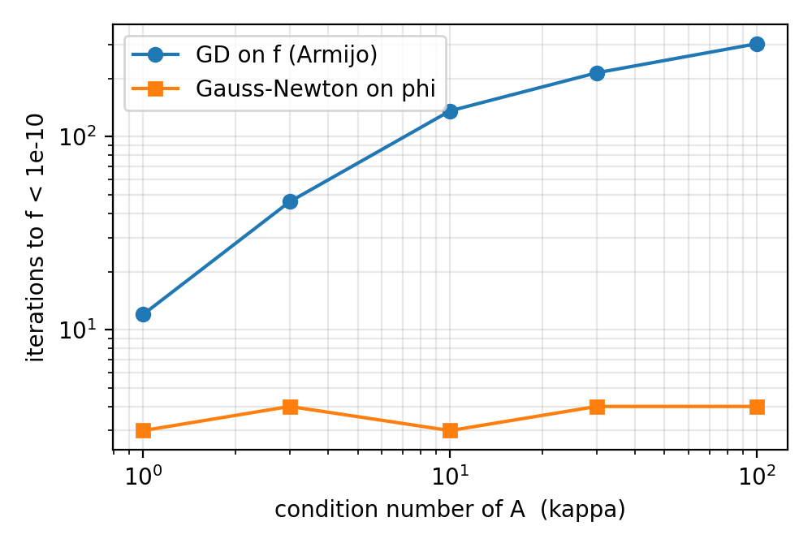

# Gauss-Newton on φ vs gradient descent on f for globally PŁ functions

A small numerical check motivated by

> N. Boumal, C. Criscitiello, Q. Rebjock, *Smooth, globally Polyak-Łojasiewicz functions are nonlinear least-squares*, arXiv:2604.07972 (2026).

The paper shows that a smooth, globally PŁ function on ℝⁿ can be written as f = f* + ‖φ(x)‖², where φ : ℝⁿ → ℝᵏ is a submersion and k is the codimension of the minimiser set. This repository asks what that structure gives algorithmically **when φ is known**: does Gauss-Newton on φ beat gradient descent on f, and how does the gap depend on the conditioning of Dφ?

## Experiments

**A. One dimension.** f(x) = x² + 3 sin²x is nonconvex but PŁ. Here φ(x) = sign(x)·√f(x) is explicit. The script checks numerically that φ′ never vanishes (so φ is a submersion), estimates the PŁ constant on [−10, 10], and compares the two methods from five starting points.

**B. Varying conditioning.** φ(x) = Ax + 0.3·sin(Bx) from ℝ²⁰ to ℝ⁵, where A has condition number κ ∈ {1, 3, 10, 30, 100}. Both methods use backtracking. Gauss-Newton uses the minimum-norm least-squares step since k < n.

## Results

Full output is in [`results.txt`](results.txt).



## Observations

1. On the minimiser set, ∇²f = 2 DφᵀDφ, so near S Gauss-Newton on φ coincides with Newton on f. The interesting regime is away from S.
2. Iteration counts are not the full cost: a Gauss-Newton step needs a least-squares solve, a gradient step only a matrix-vector product.
3. In general φ is not available. In the paper's proof it arises from the gradient flow, so a natural question is whether a computable approximation of φ away from S could act as a preconditioner.

A one-page summary is in [`note.pdf`](note.pdf).

## Run

```
pip install -r requirements.txt
python pl_experiment.py
```
Runs in a few seconds and is seeded, so the output is reproducible.

*Siddhant Gadodia, IIT Delhi*
